# Account Abstraction Contracts

The following sol2uml diagrams have been run against the [ERC-4337](https://eips.ethereum.org/EIPS/eip-4337) Account Abstraction contracts in the
[eth-infinitism/account-abstraction](https://github.com/eth-infinitism/account-abstraction)
GitHub repository. The main contracts are

* [contracts/interfaces/IAccount.sol](https://github.com/eth-infinitism/account-abstraction/blob/develop/contracts/interfaces/IAccount.sol)
* [contracts/samples/SimpleAccount.sol](https://github.com/eth-infinitism/account-abstraction/blob/develop/contracts/samples/SimpleAccount.sol)
* [contracts/core/EntryPoint.sol](https://github.com/eth-infinitism/account-abstraction/blob/develop/contracts/core/EntryPoint.sol)

The full option names have been used below rather than the short names for readability.
For example, `--baseContractNames` instead of just `-b`.

These diagrams are saved examples from the repository version used when they were generated. Later versions of the contracts may produce different diagrams. See the [sol2uml installation instructions](../../README.md#install) before running the commands.

To run the following, set the `AA` environment variable to the location of the Account Abstraction contracts. For example
```sh
export AA=../../../account-abstraction/contracts
```

## Account Interface

```sh
sol2uml class "$AA" --baseContractNames IAccount --outputFileName IAccount.svg
```

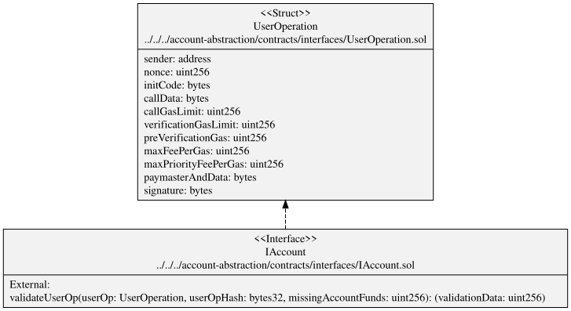

## Simple Account Hierarchy

```sh
sol2uml class "$AA" --baseContractNames SimpleAccount --hideFunctions --hideVariables --hideEnums --hideStructs --outputFileName SimpleAccountHierarchy.svg
```

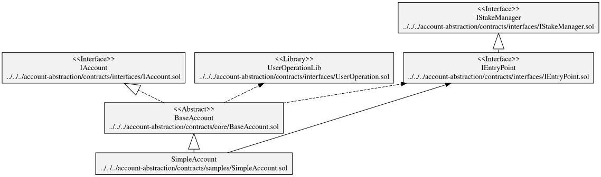

## Simple Account Squashed Public

```sh
sol2uml class "$AA" --baseContractNames SimpleAccount --squash --depth 0 --hidePrivates --outputFileName SimpleAccountSquashedPub.svg
```

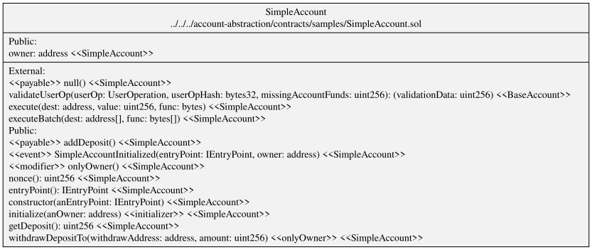

## Simple Account Squashed

```sh
sol2uml class "$AA" --baseContractNames SimpleAccount --squash --depth 0 --outputFileName SimpleAccountSquashed.svg
```

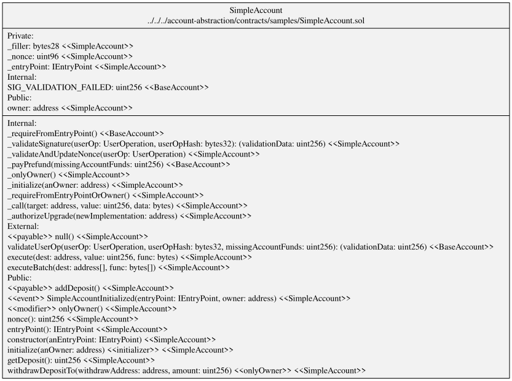


## Simple Account

```sh
sol2uml class "$AA" --baseContractNames SimpleAccount --depth 0 --outputFileName SimpleAccountDepth0.svg
```

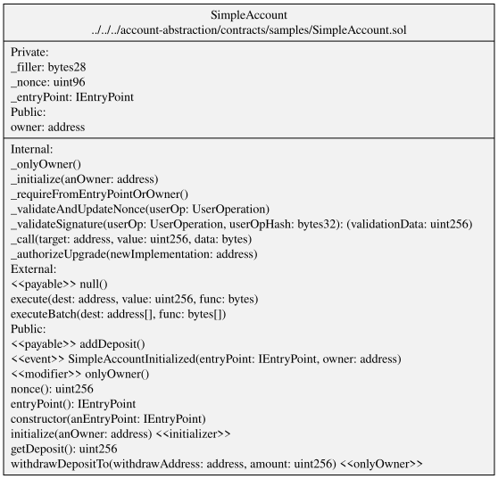

## Simple Account Depth 1

```sh
sol2uml class "$AA" --baseContractNames SimpleAccount --depth 1 --outputFileName SimpleAccountDepth1.svg
```

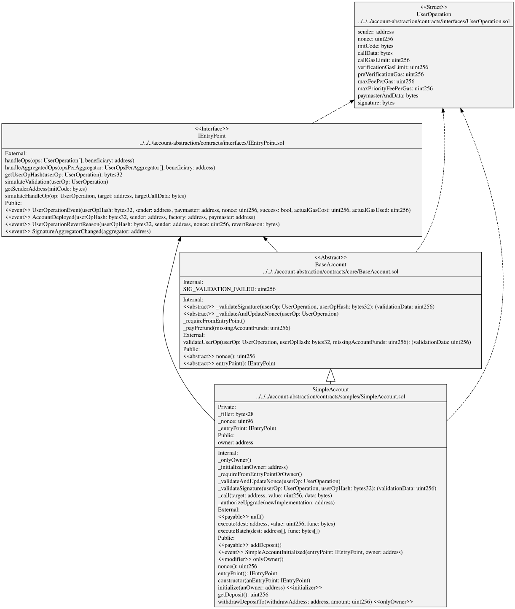

## Simple Account All Depths

```sh
sol2uml class "$AA" --baseContractNames SimpleAccount --outputFileName SimpleAccountLinked.svg
```

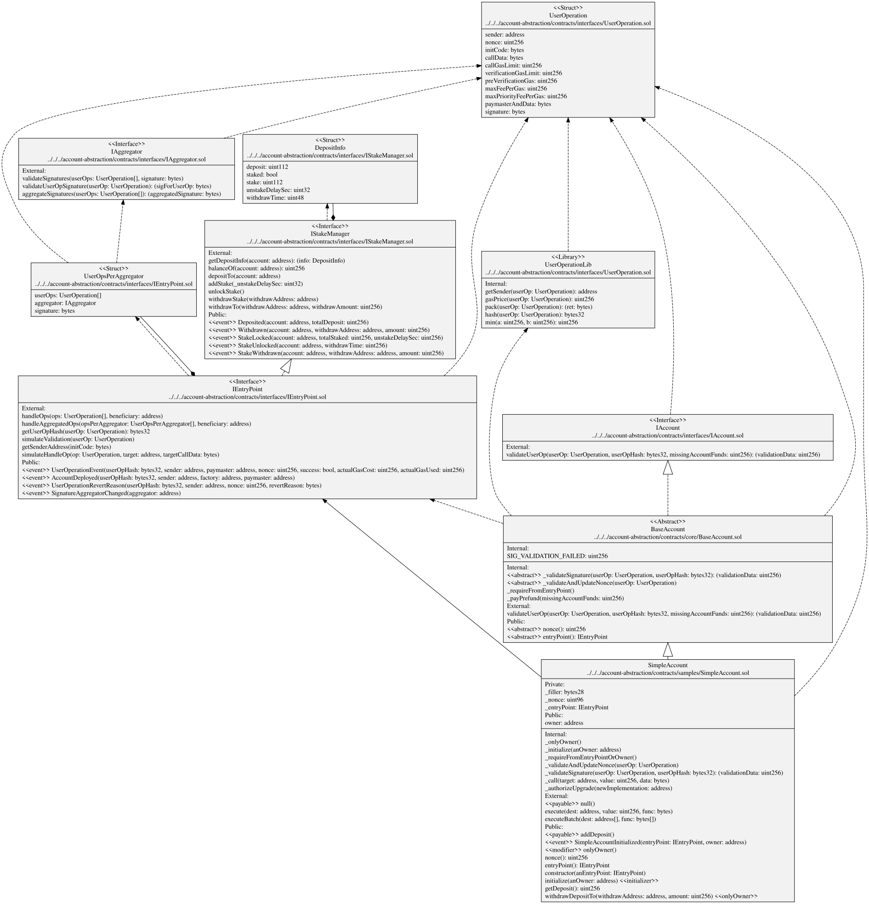

## EntryPoint Hierarchy

```sh
sol2uml class "$AA" --baseContractNames EntryPoint --hideFunctions --hideVariables --hideEnums --hideStructs --outputFileName EntryPointHierarchy.svg
```

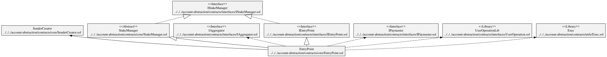

## EntryPoint Squashed Public

```sh
sol2uml class "$AA" --baseContractNames EntryPoint --squash --hideSourceContract --hidePrivates --depth 0 --outputFileName EntryPointSquashedPub.svg
```

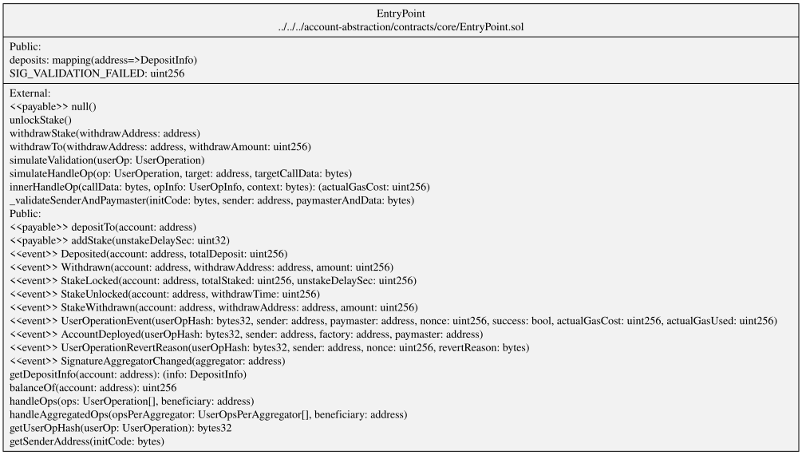

## EntryPoint Squashed Public and Private

```sh
sol2uml class "$AA" --baseContractNames EntryPoint --squash --hideSourceContract --depth 0 --outputFileName EntryPointSquashedAll.svg
```

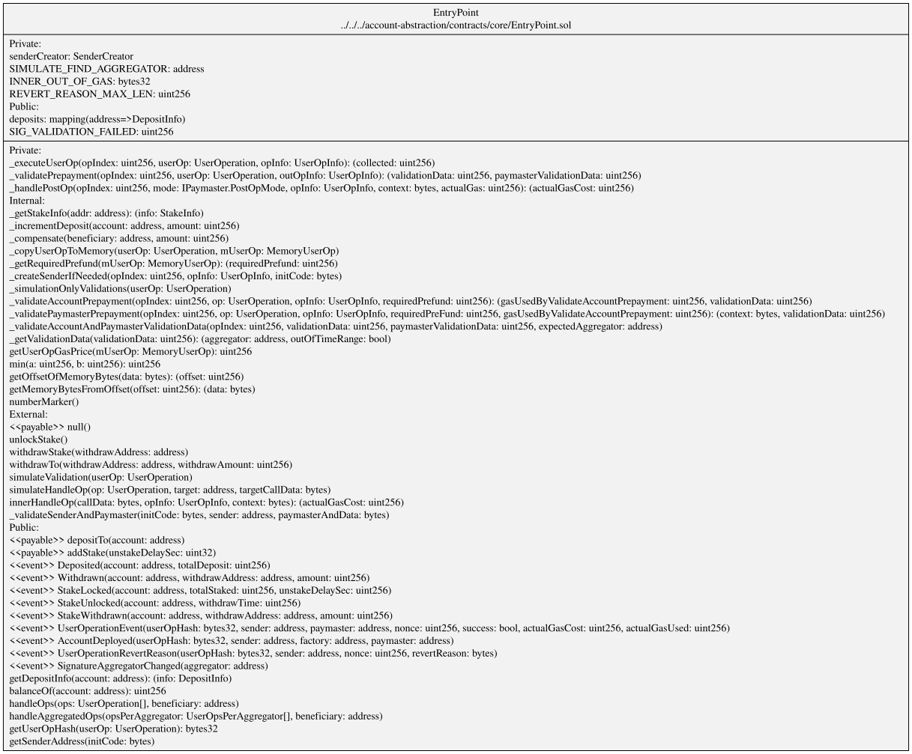

## EntryPoint Squashed with Inherited Contracts

```sh
sol2uml class "$AA" --baseContractNames EntryPoint --squash --depth 0 --outputFileName EntryPointSquashedInherit.svg
```

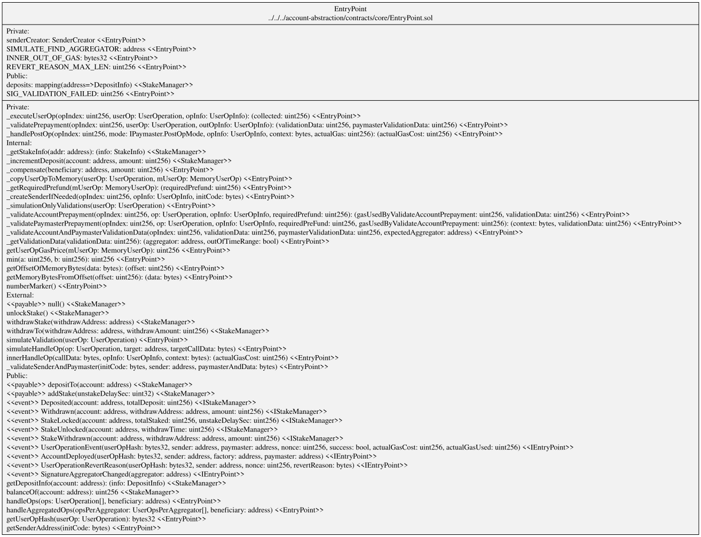

## EntryPoint Squashed Depth 1

```sh
sol2uml class "$AA" --baseContractNames EntryPoint --squash --depth 1 --outputFileName EntryPointSquashedDepth1.svg
```

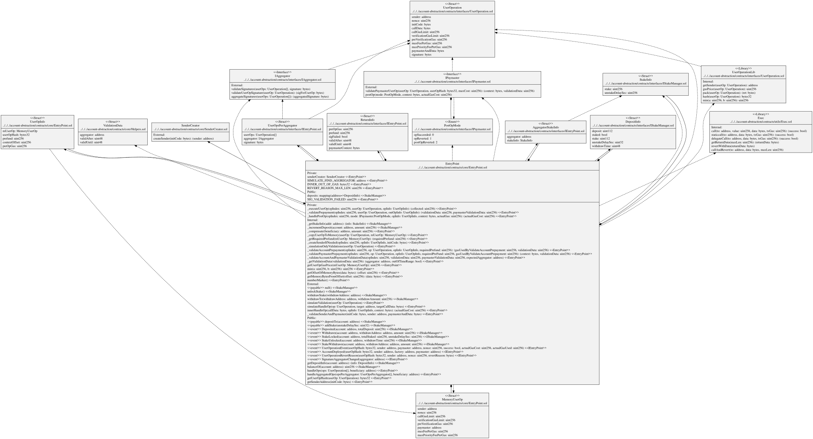

## EntryPoint Not Squashed Depth 1

```sh
sol2uml class "$AA" --baseContractNames EntryPoint --depth 1 --outputFileName EntryPointLinked.svg
```

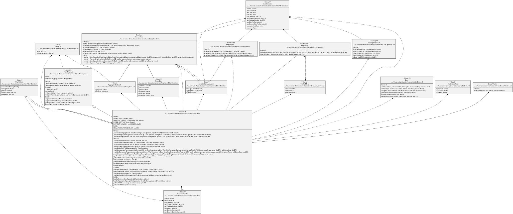

## EntryPoint All Linked

```sh
sol2uml class "$AA" --baseContractNames EntryPoint --outputFileName EntryPointLinkedAll.svg
```

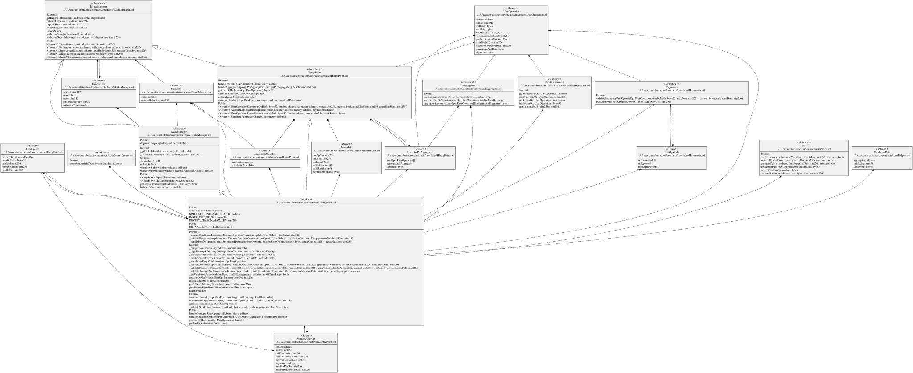

## Only Structs

```sh
sol2uml class "$AA" --hideLibraries --hideInterfaces --hideEnums --hideContracts --hideAbstracts --hideConstants --outputFileName AAStructs.svg
```

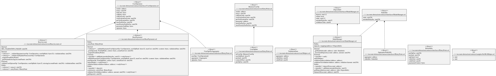

# All except samples and tests

```sh
sol2uml class "$AA" --ignoreFilesOrFolders samples,test --outputFileName all.svg
```

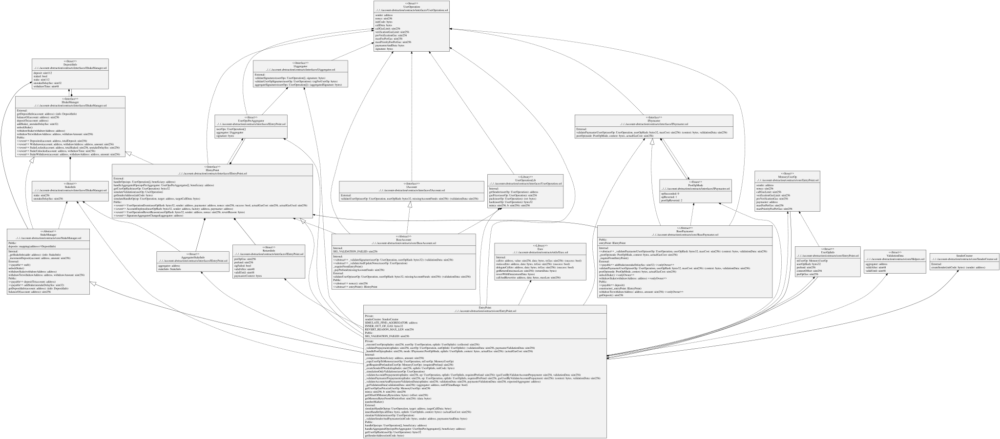
