# Example Storage Diagrams

Run local examples from the repository root. Examples using verified contract addresses require an Etherscan API key via `SCAN_API_KEY` or `-k YOUR_API_KEY`. Examples with `--data` also require `NODE_URL` (or `--url`) pointing to an RPC endpoint for the selected network. Historical block queries require a provider that serves historical state. See the [installation instructions](../../README.md#install) for Node.js and PNG requirements.

The diagrams show the contract source and state used when they were generated. Explorer source code and live storage values can change, particularly for proxy contracts.

## Local Elementary Storage

The below storage diagram is a simple example from this repository [/src/contracts/storage/BasicStorage.sol](../../src/contracts/storage/BasicStorage.sol).

Assuming this is run from the repository's root folder, the folder of the contract source file is specified with `./src/contracts`.
The root folder `./` could also be specified as sol2uml will recursively look in all the subfolders for Solidity files.
The folder and filename could also be specified with `./src/contracts/storage/BasicStorage.sol`.

The `-c --contract` option specifies the contract name the storage should be visualised for. In this case, it's the `BasicStorage` contract.

Without `-o, --outputFileName`, the filename is the contract name, so this example writes `BasicStorage.svg` in the working folder.
The output option can specify an existing folder or a filename.

```
sol2uml storage ./src/contracts -c BasicStorage
```

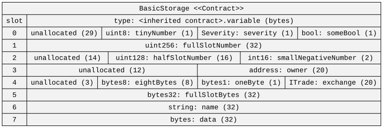

sol2uml storage diagrams will show where each storage variable is stored in the contract's slots. For each variable, the type, name and byte size is displayed.

Solidity packs consecutive value-type storage variables into a 32-byte slot when they fit; a value that does not fit starts in the next slot. You can see this in slots 0, 2 and 4 in the above diagram.
The variables are packed from right to left. sol2uml will mark any unused slot space as `unallocated` along with the number of bytes.

# Elementary Storage on Arbitrum

In this example, we'll generate a storage diagram for the same [BasicStorage](../../src/contracts/storage/BasicStorage.sol) contract deployed on Arbitrum to [0x8E2587265C68CD9EE3EcBf22DC229980b47CB960](https://arbiscan.io/address/0x8E2587265C68CD9EE3EcBf22DC229980b47CB960#code).

The `-n, --network <network>` option is used to specify the Solidity code is to be sourced from verified files on the Arbitrum blockchain explorer [Arbiscan](https://arbiscan.io).

The `-d, --data` option is used to get the contract storage slot values from a JSON-RPC node provider like [Alchemy](https://www.alchemy.com/) or [Infura](https://www.infura.io/).
The `-u, --url <url>` option can be used to specify the url of the node provider.
Alternatively, the `NODE_URL` environment variables can be used like in the following.

```
export NODE_URL=https://arb-mainnet.g.alchemy.com/v2/your-api-key
sol2uml storage -d -n arbitrum 0x8E2587265C68CD9EE3EcBf22DC229980b47CB960 -o BasicStorageData.svg
```

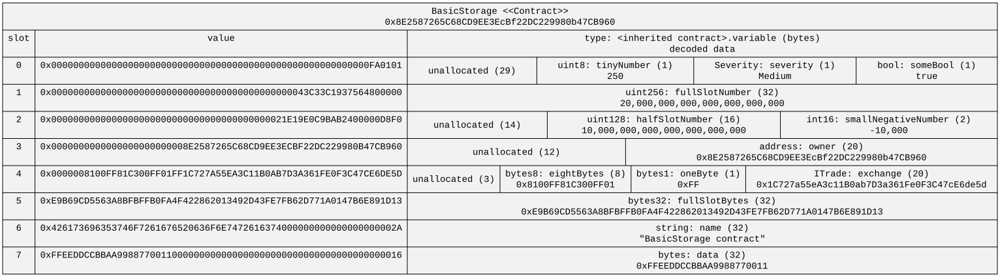

When the data option is used, the value of each storage slot is displayed in hexadecimal format. sol2uml will also parse each variable value from the slot values and display it in the appropriate format for the type.

Boolean typed variables will be displayed as a `true` or `false`. See `someBool` in the above as an example.

Numbers are displayed in comma-separated decimals.
This includes signed negative numbers like `smallNegativeNumber` in the above that converted the two bytes `0xD8F0` to -10,000.

Addresses are formatted with mixed-case checksum encoding as per [EIP-55](https://eips.ethereum.org/EIPS/eip-55). This includes contract and interface types like `ITrade` for the `exchange` variable in the above.

The 1 byte enum values are converted from a number index to the string value of the enum. For example, the `severity` variable slot value of `0x01` is mapped to `Medium` as per the `Severity` enum with values Low, Medium and High.

Strings are converted to [UTF-8](https://en.wikipedia.org/wiki/UTF-8) and any special characters escaped so they can be processed by Graphviz. See below for examples of strings 32 bytes or larger.

## Fixed-Sized Arrays

The below example was generated for the [FixedArrayStorage](../../src/contracts/storage/FixedArrayStorage.sol) contract deployed on Arbitrum to [0x796c008d8ADDCc33Da3e946Ca457432a35913c85](https://arbiscan.io/address/0x796c008d8ADDCc33Da3e946Ca457432a35913c85#code).

```
export NODE_URL=https://arb-mainnet.g.alchemy.com/v2/your-api-key
sol2uml storage -d -n arbitrum 0x796c008d8ADDCc33Da3e946Ca457432a35913c85 -o examples/storage/FixedArrayStorageData.svg
```

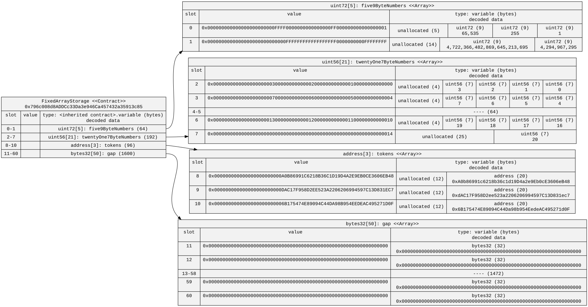

The first `five9ByteNumbers` variable is an array of five 9 byte (72 bit) numbers. As the array item is less than or equal to 16 bytes (128 bits), the array items are packed into each slot. That is, up to three array items are stored in each slot.

The second `twentyOne7ByteNumbers` variable is an array of twenty one 7 byte (56 bit) numbers.
Like the previous example, multiple array items are packed into a slot.
By default, sol2uml will just display the first two and last two slots in an array. In this case, the values for slots 4 and 5 are not fetched.

The `-a, --array <number>` option can be used to override this default of two slots being displayed at the start and end of arrays. Just be careful not to set it too high as the node provider may have restrictions on the number of slot values you can fetch.

The `tokens` array of addresses uses one slot per array item as the address type (20 bytes) is greater than 16 bytes.

Like the `twentyOne7ByteNumbers` variable, the `gap` variable will not display all 50 items in the array. sol2uml will by default just display the first two and last two slots.

## Multidimensional Fixed Arrays

This example was generated for the [MultiFixedArrayStorage](../../src/contracts/storage/MultiFixedArrayStorage.sol) contract deployed on Arbitrum to [0xe147cB7D90B9253844130E2C4A7Ef0ffB641C3ea](https://arbiscan.io/address/0xe147cB7D90B9253844130E2C4A7Ef0ffB641C3ea#code).

```
export NODE_URL=https://arb-mainnet.g.alchemy.com/v2/your-api-key
sol2uml storage -d -n arbitrum 0xe147cB7D90B9253844130E2C4A7Ef0ffB641C3ea -o MultiFixedArrayStorageData.svg
```

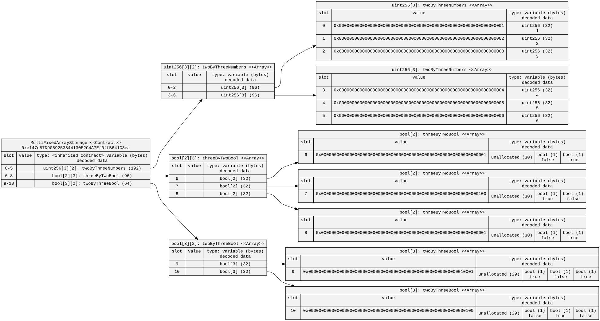

The first storage variable `twoByThreeNumbers` is a two-by-three, fixed-size, multidimensional array. Note the order of the dimensions goes from right to left when being declared.

Even though the `threeByTwoBool` and `twoByThreeBool` variables only store six boolean values, they use three and two storage slots respectively.

## Dynamic Sized Arrays

Below is an example of dynamic array storage using the [DynamicArrayStorage.sol](../../src/contracts/storage/DynamicArrayStorage.sol) contract that does not fetch the slot values.

```
sol2uml storage ./src/contracts -c DynamicArrayStorage
```

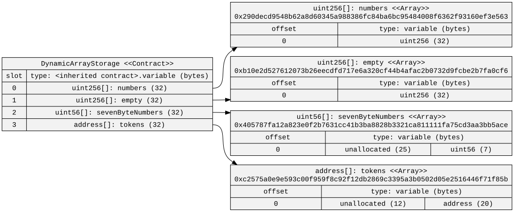

As sol2uml does not know from just looking at the code how many items are in each array, it will just show the location of the first storage slot and its structure.

The 32 byte string in hexadecimal format at the top of each dynamic array is the slot key. For example, the location of the values of `numbers` array starts from slot `0x290decd9548b62a8d60345a988386fc84ba6bc95484008f6362f93160ef3e563` in storage.
This is the keccak256 hash of slot 0 which has been assigned to the `numbers` array.

The following is generated from the `DynamicArrayStorage` contract deployed on Arbitrum to [0x66535378de7FB9219b637DBE3e3FFad33387f80B](https://arbiscan.io/address/0x66535378de7FB9219b637DBE3e3FFad33387f80B#code).

```
export NODE_URL=https://arb-mainnet.g.alchemy.com/v2/your-api-key
sol2uml storage -d -n arbitrum 0x66535378de7FB9219b637DBE3e3FFad33387f80B -o DynamicArrayStorageData.svg
```

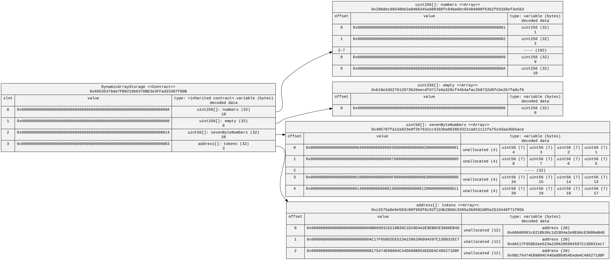

The values in the first Contract storage section is the lengths of the dynamic arrays. For example, the `numbers` array has 10 items in it.

The array storage sections show the slot offsets from the first item in the array. For example, offset 1 for the `sevenByteNumbers` variable is the next slot after the slot with key `0x405787fa12a823e0f2b7631cc41b3ba8828b3321ca811111fa75cd3aa3bb5ace`.

Even though the `empty` variable does not have any array items yet, the location of the first item is displayed so the storage structure can be seen.

## Multidimensional Dynamic Sized Arrays

Below is an example of multidimensional dynamic array storage using the [MultiDynamicArrayStorage.sol](../../src/contracts/storage/MultiDynamicArrayStorage.sol) contract.

```
sol2uml storage ./src/contracts -c MultiDynamicArrayStorage
```

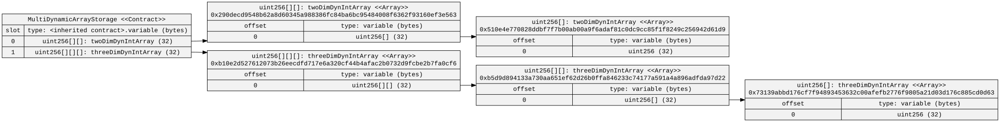

The following is generated from the `MultiDynamicArrayStorage` contract deployed on Arbitrum to [0x6f44d1108bB79710C1BBE378661d90876682E027](https://arbiscan.io/address/0x6f44d1108bB79710C1BBE378661d90876682E027#code).

```
export NODE_URL=https://arb-mainnet.g.alchemy.com/v2/your-api-key
sol2uml storage -d -n arbitrum 0x6f44d1108bB79710C1BBE378661d90876682E027 -o MultiDynamicArrayStorageData.svg
```

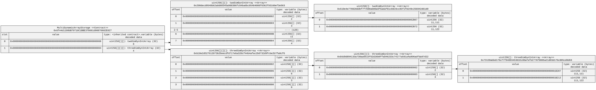

## Structs

The below example is of storage variables that use structs from the [StructStorage.sol](../../src/contracts/storage/StructStorage.sol) contract.

```
sol2uml storage ./src/contracts -c StructStorage
```

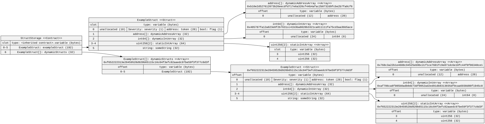

The first `exampleStruct` variables is of `ExampleStruct` type. sol2uml will display how many slots the struct uses and then reference an expanded view of how the struct variables are stored in the slots. 
If any of the struct variables are arrays, strings, bytes or other structs, they will recursively be referenced until the elementary types are reached.

The second `dynamicStructs` variable is a dynamic array of type `ExampleStruct`. When sol2uml is run without the `-d, --data` option, it does not know how long the array is so will just display what the first array item would look like.


The following is generated from the `StructStorage` contract deployed on Arbitrum to [0xB8F98C34e40E0D201CE2F3440cE92d0B5c5CfFe2](https://arbiscan.io/address/0xB8F98C34e40E0D201CE2F3440cE92d0B5c5CfFe2#code).

```
export NODE_URL=https://arb-mainnet.g.alchemy.com/v2/your-api-key
sol2uml storage -d -n arbitrum 0xB8F98C34e40E0D201CE2F3440cE92d0B5c5CfFe2 -o StructStorageData.svg
```

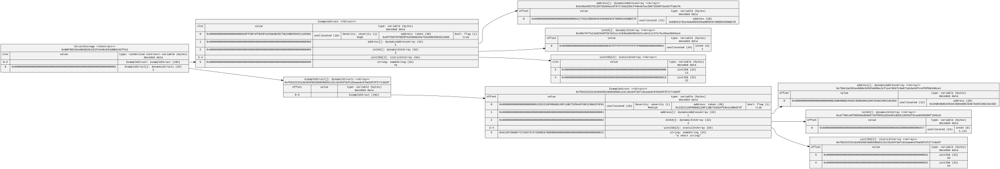

## Strings

Below is an example of string storage using the [StringStorage.sol](../../src/contracts/storage/StringStorage.sol) contract that does not fetch the slot values.

```
sol2uml storage ./src/contracts -c StringStorage
```

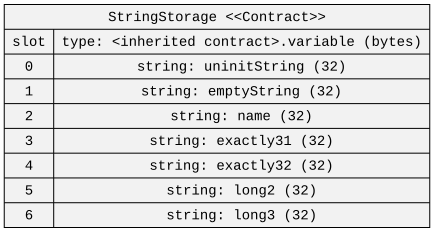

Like the dynamic arrays, sol2uml does not know how long the strings are just by looking at the code. To get the string values, the `-d, --data` option is used.
The below diagram gets the data for the `StringStorage` contract deployed on Arbitrum to [0xeF2A93be2beD1b577D460c347f82De1Ba8bD9861](https://arbiscan.io/address/0xeF2A93be2beD1b577D460c347f82De1Ba8bD9861#code).

```
export NODE_URL=https://arb-mainnet.g.alchemy.com/v2/your-api-key
sol2uml storage -d -n arbitrum 0xeF2A93be2beD1b577D460c347f82De1Ba8bD9861 -o StringStorageData.svg
```

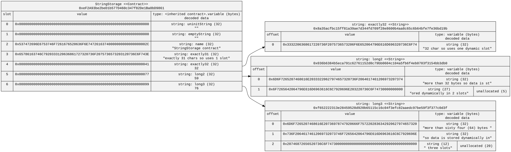

Variables `uninitString` and `emptyString` have the same slot values of zero bytes.

The `name` variable with a 22-byte string fits in a single slot.
The [UTF-8](https://en.wikipedia.org/wiki/UTF-8) encoded string is stored left-aligned in the slot. The last byte on the right stores twice the string length in bytes. Mathematically, the length is multiplied by 2.
So the 22-byte string becomes 22 * 2 = 44 which is 2C in hexadecimal.

The `long2` variable has a string that is 59 bytes long.
As it is longer than 31 bytes, it can't fit in slot 5 which the variable is assigned.
Slot 5 contains the length of the string that is left-bit shifted and the last bit set to 1.
Mathematically, the length is multiplied by 2 and 1 is added.
So the encoded length of the `long2` variable becomes 59 * 2 + 1 = 119 which is 0x77 in hexadecimal format.
sol2uml will display the decoded string lengths when strings are longer than 31 bytes and the string when they are shorter than 32 bytes. See [Solidity's storage layout documentation](https://docs.soliditylang.org/en/latest/internals/layout_in_storage.html#bytes-and-string) for the encoding rules.

If the rightmost bit of a string variable's slot is set to 1 then the string is dynamically stored in another location and then the slot just contains the encoded string length.

The `long2` string is stored from slot `0x036b6384b5eca791c62761152d0c79bb0604c104a5fb6f4eb0703f3154bb3db0` which is the keccak256 hash of the variable's slot 5.
The second slot with offset 1 is the slot with key `0x036b6384b5eca791c62761152d0c79bb0604c104a5fb6f4eb0703f3154bb3db1`.

## Mappings

Below is an example of mapping storage variables using the [MappingStorage.sol](../../src/contracts/storage/MappingStorage.sol) contract.

```
sol2uml storage ./src/contracts -c MappingStorage
```

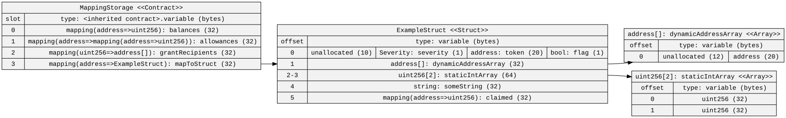

sol2uml does not fetch slot values for mapping types as no data is stored in the variable's slot. The variable's slot along with the mapped key is used to find the location of the mapped values.
Without looking at past transactions or events, sol2uml does not know what these mapped values are.

sol2uml will show the structure of any mapped struct data types like the `mapToStruct` variable in the above.

## Contract Inheritance

The following example shows the storage slots with contract inheritance. This includes [diamond inheritance](https://forum.openzeppelin.com/t/solidity-diamond-inheritance/2694), imports from other files, import aliases and duplicate contract names.

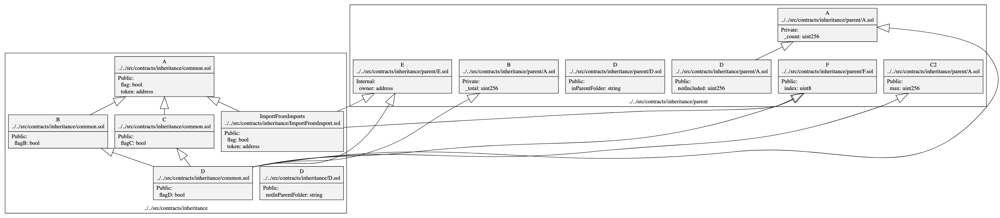

```
sol2uml class ./src/contracts/inheritance -c -f png -o examples/inheritanceDiamond.png
```

The storage slots for contract `D` in [inheritance/common.sol](../../src/contracts/inheritance/common.sol).

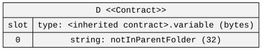

```
sol2uml storage ./src/contracts/inheritance -c D -o examples/storage/inheritanceStorage.svg
```

## Assembly Accessed Slots

The `-sn, --slotNames` option lists slots that are accessed by assembly rather than Solidity storage variables.
The option value is a comma-separate list of slot names.
The names can be a string, which will be hashed to a slot, or a 32 bytes hexadecimal string with a 0x prefix.

In the below example, `OUSD.governor` is keccak256 hashed to slot `0x7bea13895fa79d2831e0a9e28edede30099005a50d652d8957cf8a607ee6ca4a`.

The `-st, --slotTypes` options allows types to be specified for each of the named slots.
This is a comma-separated list of types or a single type if all the types are the same.

The following example is Origin's OETH Dripper contract.

The `0x360894a13ba1a3210667c828492db98dca3e2076cc3735a920a3ca505d382bbc` slot is the keccak256 hash of "eip1967.proxy.implementation" subtracted by 1.
This holds the address of the implementation contract `0x2fdfbb2b905484f1445e23a97c97f65fe0e43dec` of the proxy contract `0xc0f42f73b8f01849a2dd99753524d4ba14317eb3`.


```
sol2uml storage 0x2fdfbb2b905484f1445e23a97c97f65fe0e43dec -v \
  --data --storage 0xc0f42f73b8f01849a2dd99753524d4ba14317eb3 \
  --slotNames OUSD.governor,OUSD.pending.governor,OUSD.reentry.status,0x360894a13ba1a3210667c828492db98dca3e2076cc3735a920a3ca505d382bbc \
  --slotTypes address,address,bool,address \
  --hideExpand drip \
  -o examples/storage/origin-oeth-dripper.svg
```

If no `--slotTypes` option is used with the `--slotNames` option, sol2uml will default all the assembly accessed types to bytes32.


```
sol2uml storage 0x2fdfbb2b905484f1445e23a97c97f65fe0e43dec -v \
  --data --storage 0xc0f42f73b8f01849a2dd99753524d4ba14317eb3 \
  --slotNames OUSD.governor,OUSD.pending.governor,OUSD.reentry.status,0x360894a13ba1a3210667c828492db98dca3e2076cc3735a920a3ca505d382bbc \
  --hideExpand drip \
  -o examples/storage/origin-oeth-dripper-default.svg
```

The slot values can be hidden with the `-hv, --hideValues` option.


```
sol2uml storage 0x2fdfbb2b905484f1445e23a97c97f65fe0e43dec -v \
  --data --storage 0xc0f42f73b8f01849a2dd99753524d4ba14317eb3 \
  --slotNames OUSD.governor,OUSD.pending.governor,OUSD.reentry.status,0x360894a13ba1a3210667c828492db98dca3e2076cc3735a920a3ca505d382bbc \
  --slotTypes address,address,bool,address \
  --hideExpand drip --hideValues \
  -o examples/storage/origin-oeth-dripper-hide-values.svg
```


## USDC

The USD Coin (USDC) token deployed to [0xA0b86991c6218b36c1d19D4a2e9Eb0cE3606eB48](https://etherscan.io/address/0xA0b86991c6218b36c1d19D4a2e9Eb0cE3606eB48#code) on mainnet is a proxied contract.
For sol2uml to get the slot values, the implementation contract [0xa2327a938febf5fec13bacfb16ae10ecbc4cbdcf](https://etherscan.io/address/0xa2327a938febf5fec13bacfb16ae10ecbc4cbdcf#code)
is specified for the Solidity source and the proxy address `0xA0b86991c6218b36c1d19D4a2e9Eb0cE3606eB48` is passed to the `-s --storage` option.
The storage option is the contract that the storage state is read from.

```
export NODE_URL=https://your-node-url
sol2uml storage 0xa2327a938febf5fec13bacfb16ae10ecbc4cbdcf -d -s 0xA0b86991c6218b36c1d19D4a2e9Eb0cE3606eB48 -o usdcData.svg
```

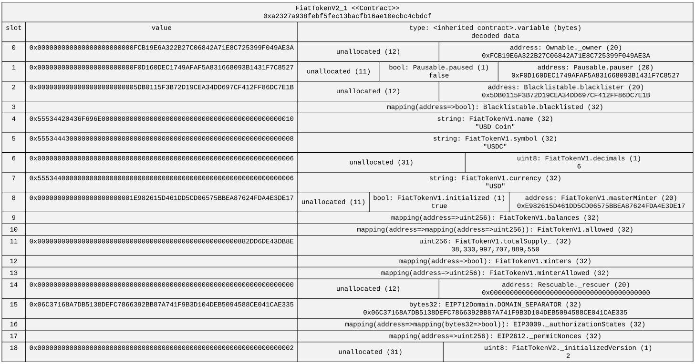

## mStable Staking contract for MTA/ETH 80/20 Balancer Pool Token (BPT)

By default, sol2uml will get the latest block number from the node provider and then all storage calls will use the same block for consistency.
The `-bn, --block <number>` option can be used to specify which block to get the storage values from.

```
sol2uml storage 0xc63a48d85CCE7C3bD4d18db9c0972a4D223e4193 -bn 16000000 -d -s 0xeFbe22085D9f29863Cfb77EEd16d3cC0D927b011 -o StakedTokenBPTData.svg
```

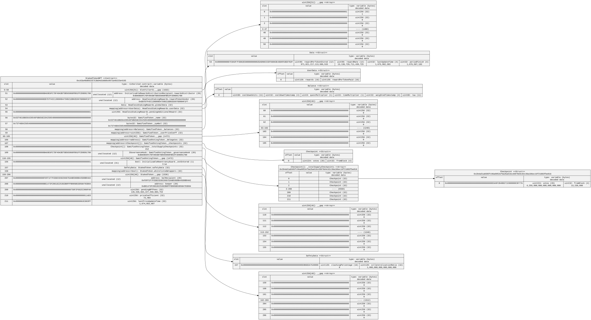

## Uniswap ETH/USDC Pool

The `value` column with the slot values in hexadecimal format can be hidden with the `-hv, --hideValues` option.

```
sol2uml  storage -d -hv 0x8ad599c3A0ff1De082011EFDDc58f1908eb6e6D8 -o ./examples/storage/UniswapV3PoolData.svg
```


